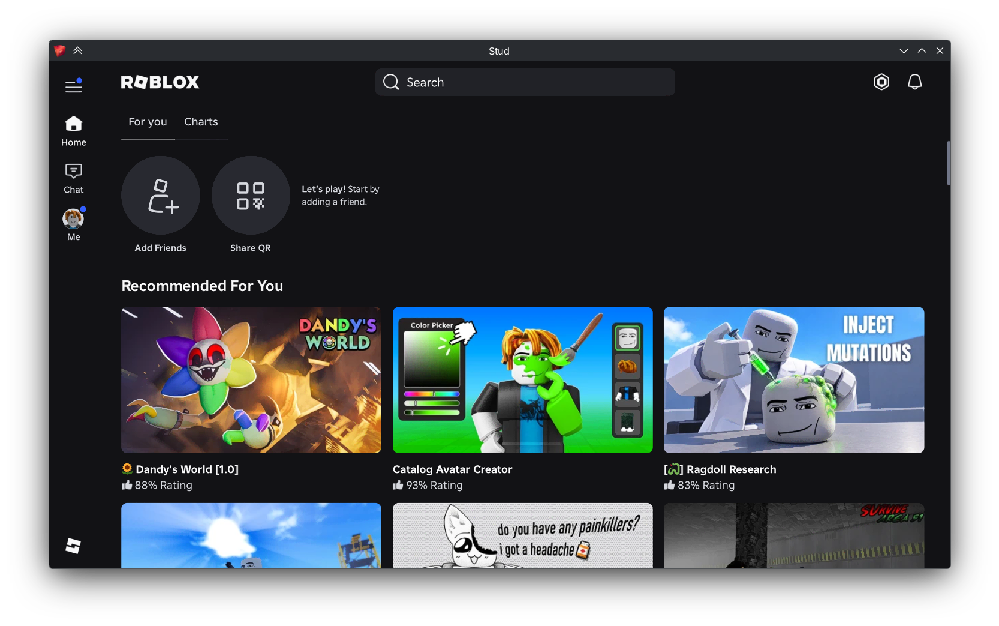
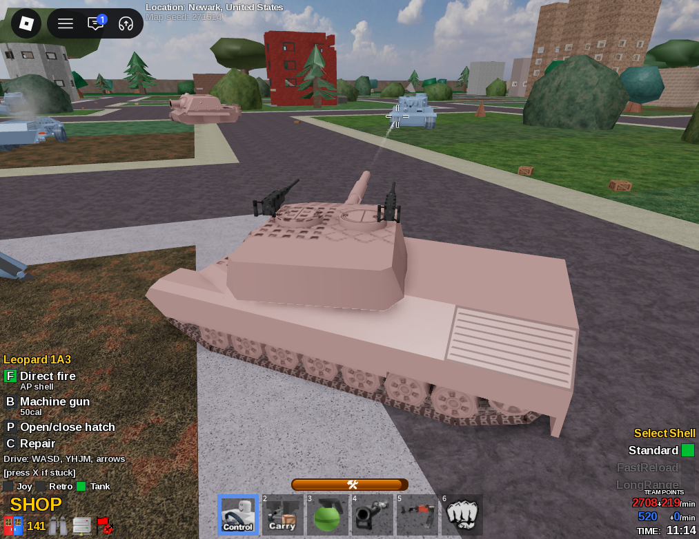
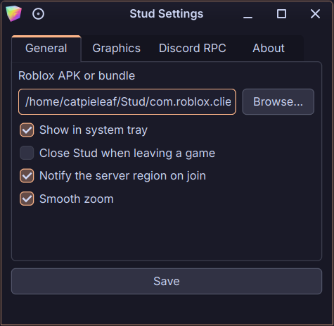
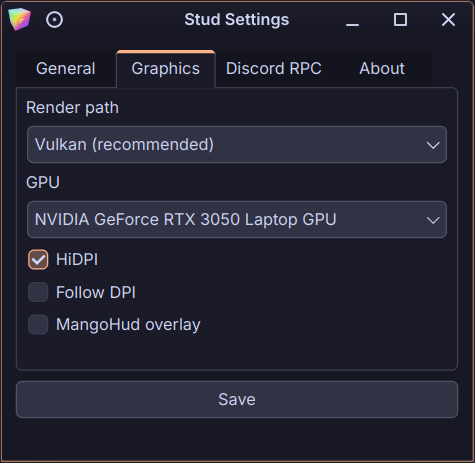
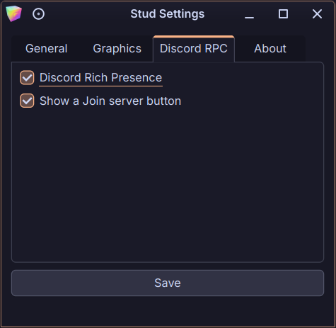
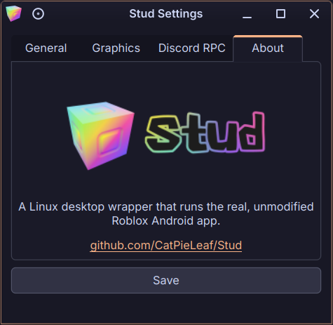

<div align="center">
  </img>
  <br/>
</div>

<div align="center">

<p align="center">
  
  
  
  
</p>

  <p align="center">Play Roblox on Linux: the real macOS client, running on your desktop.</p>
</div>

<p align="center">Stud is a <b>launcher</b>. It downloads Roblox's real macOS client from Roblox's own servers and runs it on Linux with <a href="https://github.com/microlift/rosemary">Rosemary</a>. The client is never patched, and Roblox is never shipped from here.</p>

<div align="center">

[Screenshots](#screenshots) · [Why?](#why) · [Features](#features) · [Status](#status) · [What Stud is not](#not)

[How it works](#how) · [Building](#building) · [Installation](#installation) · [Where things live](#files) · [Credits](#credits)

</div>

<br>

<p align="center">
  <a href="https://github.com/CatPieLeaf/Stud/releases"></a>
  <a href="https://cpak.it/store/apps/stud"></a>
</p>

<br>
<div align="center">
  <h4 id="screenshots"></h4>
</div>

<div align="center">
  </img>
  <p><i>The real Roblox home screen, on a Linux desktop.</i></p>
</div>

<table align="center">
  <tr>
    <td><a href="packaging/screenshots/game1.png"></a></td>
    <td><a href="packaging/screenshots/game2.png"></a></td>
    <td><a href="packaging/screenshots/game3.png"></a></td>
  </tr>
</table>

<table align="center">
  <tr>
    <td><a href="packaging/screenshots/settings1.png"></a></td>
    <td><a href="packaging/screenshots/settings2.png"></a></td>
    <td><a href="packaging/screenshots/settings3.png"></a></td>
    <td><a href="packaging/screenshots/settings4.png"></a></td>
  </tr>
</table>

<br>

<div align="center">
  <h4 id="why"></h4>
</div>

I wanted to play Roblox on Linux without it falling over. Sober kept crashing on my NVIDIA machine, and I wanted more control than it gave me: picking my own APK, deciding when Roblox updates, and no OTAs I can't see or turn off.

So I made Stud. The Android runtime (bionic) and the rendering side (glibc) are separate processes, so the graphics driver's threads stay out of the Android code, which is what fixed the NVIDIA crashes for me. You provide the APK yourself, and it's Vulkan first.

It's a one-person project, built because I wanted a launcher that stays out of the way. It works for me, and I hope it works for you too.

<br>

<div align="center">
  <h4 id="features"></h4>
</div>

 - Runs the **real** Roblox macOS client, unpatched: the desktop client, with desktop graphics
 - Downloads and updates the client from Roblox's own servers before each launch, so there is nothing to fetch by hand
 - Two processes: Stud's launcher, and the client on Rosemary
 - Runs on **Wayland and X11**, with Stud's own icon and taskbar entry
 - Your desktop's own title bar, or the macOS one, with or without its menu bar
 - Ctrl for copy, cut and paste, where the macOS client expects Command
 - An FFlags editor in Settings, with JSON import
 - `roblox://` links from a browser open straight into the experience
 - MangoHud and [GameMode](https://github.com/FeralInteractive/gamemode) switches, GPU picker, system tray
 - Export every session log as one tarball, for when you file a bug; join tickets are kept out of them

<br>

<div align="center">
  <h4 id="status"></h4>
</div>

> [!WARNING]
> **Stud is very unstable.** It boots, logs in, renders the real app and joins real games. It also breaks, hangs and does strange things. For now, treat it as something to tinker with, not something to rely on.

**Contributions of any kind are welcome**: code, bug reports, a log from a machine that isn't ours, a GPU we've never tested on, a screenshot of something rendering wrong. Open an [issue](https://github.com/CatPieLeaf/Stud/issues) and say what happened; the tray's **Export logs** puts every session in one file for you.

<br>

<div align="center">
  <h4 id="not"></h4>
</div>

 - **Not affiliated with Roblox.** Stud is an independent project, not endorsed, supported or approved by Roblox Corporation.
 - **Not a distributor.** No Roblox client is included or mirrored here. Stud downloads it from Roblox's own servers onto your machine, and Roblox remains subject to its own terms.
 - **Not a modding tool.** Stud does not inject code, patch the client, alter game behaviour or give you anything you would not have on a regular client, and it will not gain support for doing so. Requests for that will be ignored and closed.
 - **Not borrowed.** Stud shares no code with Sober or anything like it.
 - **Not an emulator.** There is no virtual machine. Rosemary runs the client's own x86_64 code directly, with the macOS interfaces it expects supplied around it.

<br>

<div align="center">
  <h4 id="how"></h4>
</div>

| process | does |
|---|---|
| `stud` | settings, deep links, downloading and updating the client, starting it, the tray, reporting a crash |
| `rosemary` | Roblox's macOS client: its window through SDL3, Metal on Vulkan, its input and sound |

The launcher stays for the whole session as the client's parent, so there is always a process left to say what happened if the client goes down.

<br>

<div align="center">
  <h4 id="building"></h4>
</div>

### 1 - Install the system packages

```bash
sudo dnf install cmake ninja-build gcc-c++ cargo qt6-qtbase-devel vulkan-headers \
  libcurl-devel libxkbcommon-devel SDL3
```

<details>
<summary>Debian / Ubuntu</summary>

```bash
sudo apt install cmake ninja-build build-essential cargo qt6-base-dev libqt6opengl6-dev \
  libvulkan-dev libcurl4-openssl-dev libxkbcommon-dev libsdl3-0
```
</details>

Rosemary needs Rust 1.99 or newer and SDL 3.4.0 at runtime; see [its README](https://github.com/microlift/rosemary#building).

### 2 - Build and run

```bash
cmake -S . -B build -G Ninja
cmake --build build
./build/ui/stud-ui
```

The build fetches Rosemary's source from its repository and compiles it. To use a Rosemary you already have, configure with `-DSTUD_BUILD_ROSEMARY=OFF` and put it on `PATH` or in `STUD_ROSEMARY`.

The first launch downloads the macOS client and Rosemary's base system, a few hundred megabytes, then goes straight to Roblox.

<details>
<summary>Making packages</summary>

```bash
cd build
cpack -G RPM                  # build/stud-<version>-1.x86_64.rpm
cpack -G DEB                  # build/stud_<version>_amd64.deb
cd ..
packaging/build-appimage.sh   # build-appimage/packages/Stud-x86_64.AppImage
```

None of them contains Roblox. The AppImage builds inside a container, so it needs `podman` or `docker`. A deb runs on the distribution that built it and anything newer.
</details>

<details>
<summary>Running the tests</summary>

```bash
ctest --test-dir build
```

Tests that need a GPU or a notification service report skipped without one. On a desktop, one real "Stud test" notification pops up.
</details>

<details>
<summary>Profiling and debugging</summary>

Every debugging switch is listed in [`docs/environment.md`](docs/environment.md).
</details>

<br>

<div align="center">
  <h4 id="installation"></h4>
</div>

Pre-built packages are on the [Releases](https://github.com/CatPieLeaf/Stud/releases) page.

## 🔵 R P M  ( F E D O R A )

Stud is in [Terra](https://terra.fyralabs.com), so it installs and updates like any other package. Add the Terra repository once:

```bash
sudo dnf install --nogpgcheck --repofrompath 'terra,https://repos.fyralabs.com/terra$releasever' terra-release
```

Then install Stud:

```bash
sudo dnf install stud
```

Or install the rpm from a release by hand:

```bash
sudo dnf install ./stud-*.x86_64.rpm
```

## 🟣 D E B  ( D E B I A N  /  U B U N T U )

```bash
sudo apt install ./stud_*_amd64.deb
```

Installs and starts on Ubuntu 24.04, Debian 13, Ubuntu 26.04 and the Mint releases built on them.

## 🔷 A R C H  ( P A C M A N )

Stud is not on the AUR. Get the package from [Releases](https://github.com/CatPieLeaf/Stud/releases):

```bash
sudo pacman -U stud-*-x86_64.pkg.tar.zst
```

To build from source instead, use the PKGBUILD at `packaging/aur/`.

## 🔶 F L A T P A K

```bash
flatpak install --user ./stud-*-x86_64.flatpak
flatpak run io.github.catpieleaf.Stud
```

Not on Flathub yet, so it's a file attached to each release rather than a remote. The manifest is in `packaging/flatpak`.

## ⬛ C P A K

```bash
cpak install github.com/catpieleaf/stud
```

[cpak](https://github.com/Containerpak/cpak) installs from an OCI image and runs it rootless. Stud is in the [cpak store](https://cpak.it/store/apps/stud).

## ❄️ N I X

These commands need flakes, which Nix keeps behind a setting. On NixOS, add this to `configuration.nix` and rebuild:

```nix
nix.settings.experimental-features = [ "nix-command" "flakes" ];
```

On any other distro, add this line to `~/.config/nix/nix.conf`:

```
experimental-features = nix-command flakes
```

Try it without installing:

```bash
nix run github:CatPieLeaf/Stud
```

Or install it for your user (`nix profile install` on Nix older than 2.30):

```bash
nix profile add github:CatPieLeaf/Stud
```

Or on NixOS, add the flake as an input and install it system-wide:

```nix
# flake.nix
{
  inputs.nixpkgs.url = "github:NixOS/nixpkgs/nixos-unstable";
  inputs.stud.url = "github:CatPieLeaf/Stud";

  outputs = { nixpkgs, stud, ... }: {
    nixosConfigurations.nixos = nixpkgs.lib.nixosSystem {
      modules = [
        { nixpkgs.overlays = [ stud.overlays.default ]; }
        ./configuration.nix
      ];
    };
  };
}

# configuration.nix
environment.systemPackages = [ pkgs.stud ];
hardware.graphics.enable = true;
```

Use your own host name in place of `nixos`. On Nix outside NixOS, run it through [nixGL](https://github.com/nix-community/nixGL) so it can find your graphics driver.

## 🟠 A P P I M A G E  ( A N Y _ D I S T R O )

```bash
chmod +x Stud-x86_64.AppImage
./Stud-x86_64.AppImage
```

> [!TIP]
> Run this once to get a taskbar icon and make `roblox://` links from your browser open Stud:
> ```bash
> ./Stud-x86_64.AppImage --install-desktop-entry
> ```

> [!NOTE]
> The rpm and Arch package need glibc 2.43: Fedora 44+ or a current rolling release. The AppImage carries its own glibc, so it's the one to use on anything older.

<br>

<div align="center">
  <h4 id="files"></h4>
</div>

| path | what |
|---|---|
| `~/.config/stud/` | `config.json`, and `flags.json` if you hand-write FFlag overrides; Stud writes them into the client's `ClientAppSettings.json` at launch |
| `~/.local/share/stud/client/` | the macOS client, as Roblox's servers ship it |
| `~/.local/share/stud/prefix/` | Rosemary's prefix: Roblox's own settings, login and data |
| `~/.local/state/stud/logs/` | one log per session, Stud's and the client's. This is the file to read when something goes wrong, and the one to attach to a bug report |

In a Flatpak these live under the sandbox's own home, so `~/.config/stud/` becomes `~/.var/app/io.github.catpieleaf.Stud/config/stud/` and the rest follow.

<br>

<div align="center">
  <h4 id="credits"></h4>
</div>

Roblox is a trademark of Roblox Corporation. Stud is an independent, non-commercial project and is not affiliated with, endorsed by or supported by them.

 - [Rosemary](https://github.com/microlift/rosemary): runs the macOS client on Linux (GPL-3.0)
 - [volk](https://github.com/zeux/volk): Vulkan entry points, for the GPU picker (MIT)
 - [nlohmann/json](https://github.com/nlohmann/json) and [miniz](https://github.com/richgel999/miniz) (MIT)
 - Qt, and on the AppImage the Breeze widget style (LGPL)
 - [Anylinux AppImages](https://github.com/pkgforge-dev/Anylinux-AppImages), [uruntime](https://github.com/VHSgunzo/uruntime) and [sharun](https://github.com/VHSgunzo/sharun): how the AppImage is built and run (MIT)
 - [Boblox Classic](https://www.deviantart.com/ripoof/art/Roblox-Classic-FONT-880246616): the typeface in Stud's logo, by ripoof. The font itself is not shipped

Stud itself is **AGPLv3**, with one additional permission under section 7 ([`LICENSE.exception`](LICENSE.exception)) covering the Roblox client Stud runs but never distributes. Stud is and always will be Open Source.

[`NOTICE.md`](NOTICE.md) covers the rest: every third-party licence, trademarks, your Roblox account, and what does and does not leave your machine. A package installs each licence to `/usr/share/licenses/stud/`.

---
<br>

<div align="center">
  </img>
</div>
