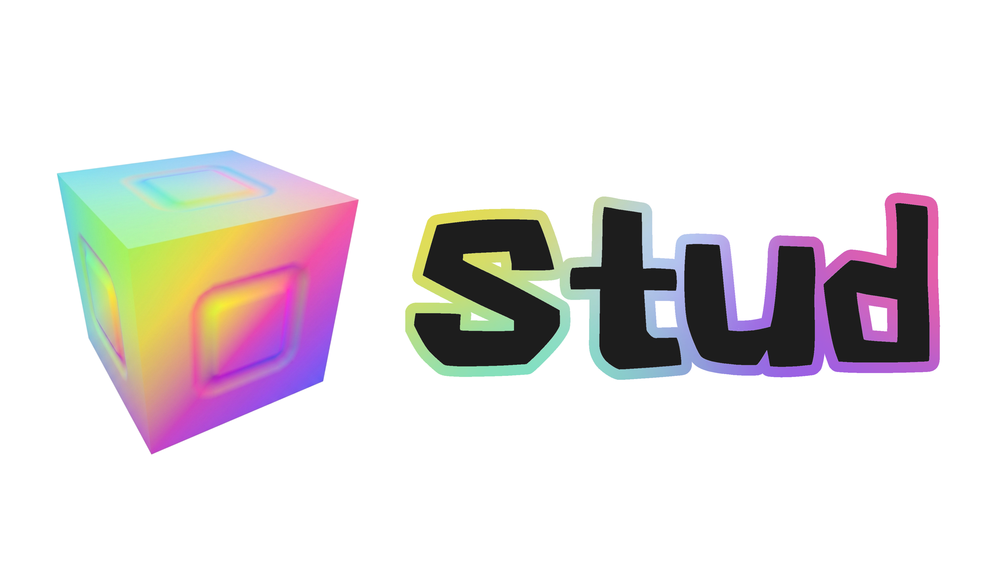
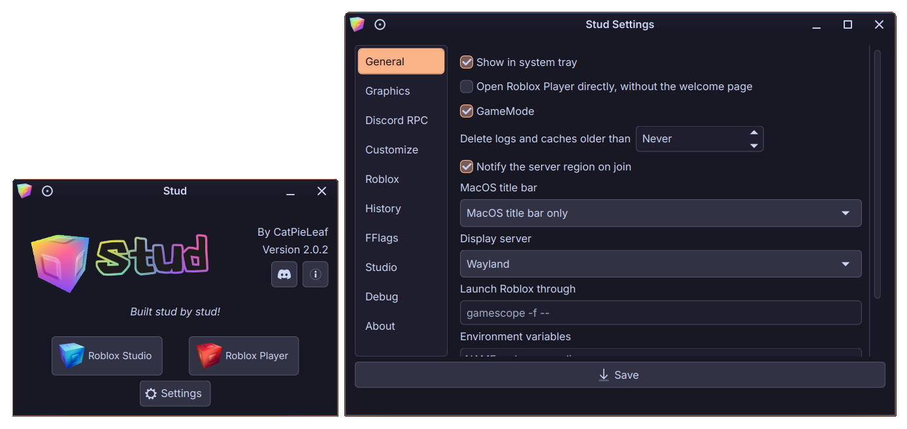
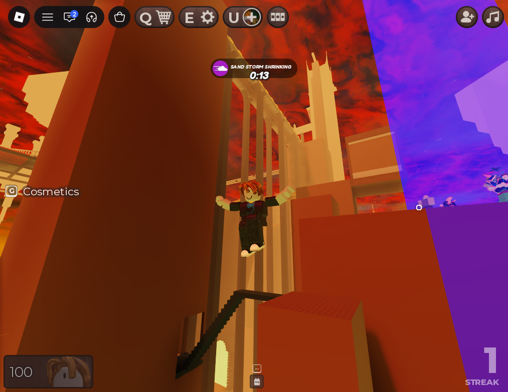
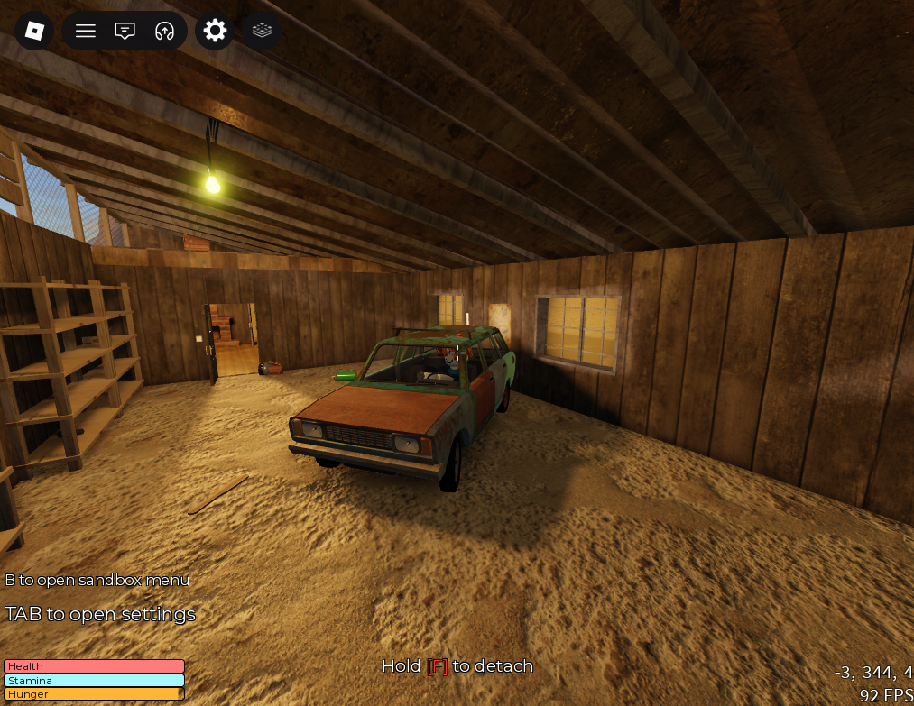

<div align="center">
  </img>
  <br/>
</div>

<div align="center">

<p align="center">
  
  
  
  
  <a href="https://discord.gg/6dmBTA4cJw"></a>
</p>

  <p align="center">Play Roblox on Linux: the real macOS client, running on your desktop.</p>
</div>

<p align="center">Stud is a <b>launcher</b>. It downloads Roblox's real macOS client from Roblox's own servers and runs it on Linux with <a href="https://github.com/microlift/rosemary">Rosemary</a>. The client is never patched, and Roblox is never shipped from here.</p>

<div align="center">

[Screenshots](#screenshots) · [Why?](#why) · [Features](#features) · [Contributions](#contributions) · [What Stud is not](#not)

[How it works](#how) · [Building](#building) · [Installation](#installation) · [Where things live](#files) · [Credits](#credits)

</div>

<br>

<p align="center">
  <a href="https://github.com/CatPieLeaf/Stud/releases"></a>
  <a href="https://cpak.it/store/apps/stud"></a>
  <a href="https://flathub.org/en/apps/io.github.catpieleaf.Stud"></a>
</p>

<br>
<div align="center">
  <h4 id="screenshots"></h4>
</div>

<div align="center">
  </img>
</div>

<table align="center">
  <tr>
    <td><a href="packaging/screenshots/home.png"></a></td>
    <td><a href="packaging/screenshots/game1.png"></a></td>
    <td><a href="packaging/screenshots/game2.png"></a></td>
    <td><a href="packaging/screenshots/game3.png"></a></td>
  </tr>
</table>

<br>

<div align="center">
  <h4 id="why"></h4>
</div>

I wanted to play Roblox on Linux without it falling over. Sober kept crashing on my NVIDIA machine, and I wanted more control than it gave me: picking my own APK, deciding when Roblox updates, and no OTAs I can't see or turn off.

So I made Stud. The first version ran Roblox's Android client; Stud 2.0 runs the real macOS desktop client instead, on [Rosemary](https://github.com/microlift/rosemary), so it's the full desktop Roblox rather than a phone app on a big screen. Stud fetches the client from Roblox's own servers, keeps it up to date, and gets out of the way.

It's a one-person project, built because I wanted a launcher that stays out of the way. It works for me, and I hope it works for you too.

<br>

<div align="center">
  <h4 id="features"></h4>
</div>

 - Runs the **real** Roblox macOS client, unpatched: the desktop client, with desktop graphics
 - Downloads and updates the client from Roblox's own servers before each launch, so there is nothing to fetch by hand, and checks its code is still what Roblox shipped. When Roblox puts your account on a test channel, Stud installs that channel's build
 - Two processes: Stud's launcher, and the client on Rosemary
 - Runs on **Wayland and X11**, with Stud's own icon and taskbar entry
 - Your desktop's own title bar, or the macOS one, with or without its menu bar
 - FastFlags: an editor with JSON import, profiles, presets (MSAA, texture quality, graphics level, mesh detail, grass, gray sky), and a warning for flags Roblox ignores, with Clean list
 - Customizations: textures, sounds, fonts and cursors over Roblox's own content, put back when removed; generated cursor, shift lock, emote wheel, death sound and font; import from Bloxstrap, Fishstrap or Froststrap. A new set that crashes Roblox's next start is set aside, and the last set that worked comes back
 - Roblox's own settings (volume, sensitivity, camera, fullscreen and more) editable from Stud
 - Vulkan or OpenGL, with VSync, adaptive VSync, or uncapped with or without tearing
 - **Upscaling** on Vulkan: lower the render resolution and the frame is rebuilt at your window's size. **RAVU-Zoom AR**, with FidelityFX RCAS sharpening after it, is the better picture; **SGSR1 ED** is the lightweight one, for laptops and integrated GPUs
 - Game history with time played, the servers you joined and where they are, rejoining a server, and game shortcuts in the application menu; either kind of history can be turned off
 - Roblox and **Roblox Studio**: opened on its own, Stud asks which, and keeps each up to date. Studio gets its own FastFlags, Ctrl in place of Command in every shortcut, and its Plugins folder one click away
 - `roblox://` links from a browser open straight into the experience, Studio's links reach Studio, and `.rbxl`/`.rbxlx` place files open in Studio
 - Discord Rich Presence as Roblox itself, with the game's name as your status and what the game reports through BloxstrapRPC, an optional Join button, and Studio presence with the place you are developing and whether you are in a script
 - Optional notification of which country the game server is in
 - A frame rate limit for while Roblox is in the background
 - MangoHud and [GameMode](https://github.com/FeralInteractive/gamemode) switches, GPU picker, system tray
 - A launch wrapper (gamescope, prime-run, ...) and your own environment variables for Roblox
 - The AppImage updates itself; the Flatpak names the `flatpak override` command for any permission taken from it
 - Export every session log as one tarball, for when you file a bug; join tickets are kept out of them

<br>

<div align="center">
  <h4 id="contributions"></h4>
</div>

**Contributions of any kind are welcome**: code, bug reports, a log from a machine that isn't ours, a GPU we've never tested on, a screenshot of something rendering wrong. Open an [issue](https://github.com/CatPieLeaf/Stud/issues) and say what happened; the tray's **Export logs** puts every session in one file for you.

<br>

<div align="center">
  <h4 id="not"></h4>
</div>

 - **Not affiliated with Roblox.** Stud is an independent project, not endorsed, supported or approved by Roblox Corporation.
 - **Not a distributor.** No Roblox client is included or mirrored here. Stud downloads it from Roblox's own servers onto your machine, and Roblox remains subject to its own terms.
 - **Not a modding tool.** Stud does not inject code, patch the client, alter game behaviour or give you anything you would not have on a regular client, and it will not gain support for doing so. Requests for that will be ignored and closed.
 - **Not borrowed.** Stud shares no code with Sober or anything like it.
 - **Not an emulator.** There is no virtual machine. Rosemary runs the client's own x86_64 code directly, with the macOS interfaces it expects supplied around it.

<br>

<div align="center">
  <h4 id="how"></h4>
</div>

| process | does |
|---|---|
| `stud` | settings, deep links, downloading and updating the client, starting it, the tray, reporting a crash |
| `rosemary` | Roblox's macOS client: its window through SDL3, Metal on Vulkan, its input and sound |

The launcher stays for the whole session as the client's parent, so there is always a process left to say what happened if the client goes down.

<br>

<div align="center">
  <h4 id="building"></h4>
</div>

### 1 - Install the system packages

```bash
sudo dnf install cmake ninja-build gcc-c++ git cargo glslc \
  qt6-qtbase-devel \
  libcurl-devel openssl-devel libsecret-devel zlib-devel systemd-devel \
  libxkbcommon-devel SDL3 wpewebkit
```

`wpewebkit` comes from [Terra](https://terra.fyralabs.com); Fedora itself does not package WPE WebKit.

<details>
<summary>Debian / Ubuntu</summary>

```bash
sudo apt install cmake ninja-build build-essential git glslc \
  qt6-base-dev \
  libgles-dev libcurl4-openssl-dev libssl-dev libsecret-1-dev zlib1g-dev libudev-dev libxkbcommon-dev libsdl3-0 \
  libwpewebkit-2.0-1
```

Ubuntu has no WPE WebKit 2.0; without it the client's sign-in and web pages stay blank, so use the AppImage or the Flatpak there.

Ubuntu's cargo is older than Rosemary needs; install Rust with [rustup](https://rustup.rs) instead.
</details>

Rosemary needs Rust 1.99 or newer, and SDL 3.4, FFmpeg and WPE WebKit at runtime. See [its README](https://github.com/microlift/rosemary#building).

### 2 - Build and run

```bash
cmake -S . -B build -G Ninja
cmake --build build
./build/ui/stud-ui
```

The build fetches Rosemary's source from Stud's fork, [rosemary-stud](https://github.com/CatPieLeaf/rosemary-stud) (branch `stud`: upstream Rosemary with Stud's changes on top), and compiles it. To use a Rosemary you already have, configure with `-DSTUD_BUILD_ROSEMARY=OFF` and put it on `PATH` or in `STUD_ROSEMARY`.

The first launch downloads the macOS client and Rosemary's base system, a few hundred megabytes, then goes straight to Roblox.

<details>
<summary>Making packages</summary>

```bash
cd build
cpack -G RPM                  # build/stud-<version>-1.x86_64.rpm
cpack -G DEB                  # build/stud_<version>_amd64.deb
cd ..
packaging/build-appimage.sh   # build-appimage/packages/Stud-x86_64.AppImage
```

None of them contains Roblox. The AppImage builds inside a container, so it needs `podman` or `docker`. A deb runs on the distribution that built it and anything newer.
</details>

<details>
<summary>Running the tests</summary>

```bash
ctest --test-dir build
```

Tests that need a GPU or a notification service report skipped without one. On a desktop, one real "Stud test" notification pops up.
</details>

<details>
<summary>Profiling and debugging</summary>

Every debugging switch is listed in [`docs/environment.md`](docs/environment.md).
</details>

<br>

<div align="center">
  <h4 id="installation"></h4>
</div>

Pre-built packages are on the [Releases](https://github.com/CatPieLeaf/Stud/releases) page.

> [!NOTE]
> **Updating from Stud 1.x:** install 2.0 over it as usual. At its first start Stud removes 1.x's Android engine, APK and caches, which run to gigabytes, and keeps your settings (the ones 2.0 still has), FFlags, customizations and logs. You'll log in to Roblox again, in the new client.

## 🔵 R P M  ( F E D O R A )

Stud is in [Terra](https://terra.fyralabs.com), so it installs and updates like any other package. Add the Terra repository once:

```bash
sudo dnf install --nogpgcheck --repofrompath 'terra,https://repos.fyralabs.com/terra$releasever' terra-release
```

Then install Stud:

```bash
sudo dnf install stud
```

Or install the rpm from a release by hand. It installs without Terra, but Roblox's sign-in needs WPE WebKit, which only Terra has.

```bash
sudo dnf install ./stud-*.x86_64.rpm
```

For that, you'll need to use the command above to add Terra's repository. Then install WPE WebKit:

```bash
sudo dnf install wpewebkit
```

## 🟣 D E B  ( D E B I A N  /  U B U N T U )

```bash
sudo apt install ./stud_*_amd64.deb
```

Installs and starts on Ubuntu 26.04, Debian 14 and newer, and the Mint releases built on them. On Ubuntu 24.04, Mint 22 or Debian 13, use the AppImage or the Flatpak: Stud 2.0 needs Qt 6.9 and SDL 3.4, which those do not have.

## 🔷 A R C H  ( P A C M A N )

Stud is not on the AUR. Get the package from [Releases](https://github.com/CatPieLeaf/Stud/releases):

```bash
sudo pacman -U stud-*-x86_64.pkg.tar.zst
```

To build from source instead, use the PKGBUILD at `packaging/aur/`.

## 🔶 F L A T P A K

Stud is on [Flathub](https://flathub.org/en/apps/io.github.catpieleaf.Stud), so it installs and updates like any other Flatpak:

```bash
flatpak install flathub io.github.catpieleaf.Stud
flatpak run io.github.catpieleaf.Stud
```

Or install the bundle from a release by hand:

```bash
flatpak install --user ./stud-*-x86_64.flatpak
```

The manifest is in `packaging/flatpak`.

## ⬛ C P A K

```bash
cpak install github.com/catpieleaf/stud
```

[cpak](https://github.com/Containerpak/cpak) installs from an OCI image and runs it rootless. Stud is in the [cpak store](https://cpak.it/store/apps/stud).

## ❄️ N I X

These commands need flakes, which Nix keeps behind a setting. On NixOS, add this to `configuration.nix` and rebuild:

```nix
nix.settings.experimental-features = [ "nix-command" "flakes" ];
```

On any other distro, add this line to `~/.config/nix/nix.conf`:

```
experimental-features = nix-command flakes
```

Try it without installing:

```bash
nix run github:CatPieLeaf/Stud
```

Or install it for your user (`nix profile install` on Nix older than 2.30):

```bash
nix profile add github:CatPieLeaf/Stud
```

Or on NixOS, add the flake as an input and install it system-wide:

```nix
# flake.nix
{
  inputs.nixpkgs.url = "github:NixOS/nixpkgs/nixos-unstable";
  inputs.stud.url = "github:CatPieLeaf/Stud";

  outputs = { nixpkgs, stud, ... }: {
    nixosConfigurations.nixos = nixpkgs.lib.nixosSystem {
      modules = [
        { nixpkgs.overlays = [ stud.overlays.default ]; }
        ./configuration.nix
      ];
    };
  };
}

# configuration.nix
environment.systemPackages = [ pkgs.stud ];
hardware.graphics.enable = true;
```

Use your own host name in place of `nixos`. On Nix outside NixOS, run it through [nixGL](https://github.com/nix-community/nixGL) so it can find your graphics driver.

## 🟠 A P P I M A G E  ( A N Y _ D I S T R O )

```bash
chmod +x Stud-x86_64.AppImage
./Stud-x86_64.AppImage
```

> [!TIP]
> Run this once to get a taskbar icon and make `roblox://` links from your browser open Stud:
> ```bash
> ./Stud-x86_64.AppImage --install-desktop-entry
> ```

> [!NOTE]
> The rpm and Arch package need glibc 2.43: Fedora 44+ or a current rolling release. The AppImage carries its own glibc, so it's the one to use on anything older.

<br>

<div align="center">
  <h4 id="files"></h4>
</div>

| path | what |
|---|---|
| `~/.config/stud/` | `config.json`, and `flags.json` if you hand-write FFlag overrides; Stud writes them into the client's `ClientAppSettings.json` at launch. `flag-profiles/` holds saved FFlag profiles, and `customizations/` (`studio-customizations/` for Studio) the files laid over Roblox's own content |
| `~/.local/share/stud/client/` | the macOS client, as Roblox's servers ship it |
| `~/.local/share/stud/prefix/` | Rosemary's prefix: Roblox's own settings, login and data, and the cookies and cache of the client's web pages |
| `~/.local/state/stud/logs/` | one log per session, Stud's and the client's. This is the file to read when something goes wrong, and the one to attach to a bug report |

In a Flatpak these live under the sandbox's own home, so `~/.config/stud/` becomes `~/.var/app/io.github.catpieleaf.Stud/config/stud/` and the rest follow.

<br>

<div align="center">
  <h4 id="credits"></h4>
</div>

Roblox is a trademark of Roblox Corporation. Stud is an independent, non-commercial project and is not affiliated with, endorsed by or supported by them.

 - [Rosemary](https://github.com/microlift/rosemary): runs the macOS client on Linux (GPL-3.0), built from Stud's fork, [rosemary-stud](https://github.com/CatPieLeaf/rosemary-stud)
 - [mpv-prescalers](https://github.com/bjin/mpv-prescalers): the RAVU-Zoom upscaler, compiled into Rosemary (LGPL-3.0-or-later)
 - [Snapdragon Game Super Resolution](https://github.com/SnapdragonStudios/snapdragon-gsr): the SGSR upscaler, compiled into Rosemary (BSD-3-Clause)
 - [AMD FidelityFX Super Resolution 1](https://github.com/GPUOpen-Effects/FidelityFX-FSR): RCAS, the sharpening pass after RAVU, compiled into Rosemary (MIT)
 - [miniz](https://github.com/richgel999/miniz) (MIT)
 - [Bloxstrap](https://github.com/bloxstraplabs/bloxstrap): the classic cursors, character sounds and avatar background, downloaded from its repository when you choose them (MIT)
 - Qt, and on the AppImage the Breeze widget style (LGPL)
 - [Anylinux AppImages](https://github.com/pkgforge-dev/Anylinux-AppImages), [uruntime](https://github.com/VHSgunzo/uruntime) and [sharun](https://github.com/VHSgunzo/sharun): how the AppImage is built and run (MIT)
 - [Boblox Classic](https://www.deviantart.com/ripoof/art/Roblox-Classic-FONT-880246616): the typeface in Stud's logo, by ripoof. The font itself is not shipped

Stud itself is **AGPLv3**, with one additional permission under section 7 ([`LICENSE.exception`](LICENSE.exception)) covering the Roblox client Stud runs but never distributes. Stud is and always will be Open Source.

[`NOTICE.md`](NOTICE.md) covers the rest: every third-party licence, trademarks, your Roblox account, and what does and does not leave your machine. A package installs each licence to `/usr/share/licenses/stud/`.

---

<div align="center">
  </img>
</div>
