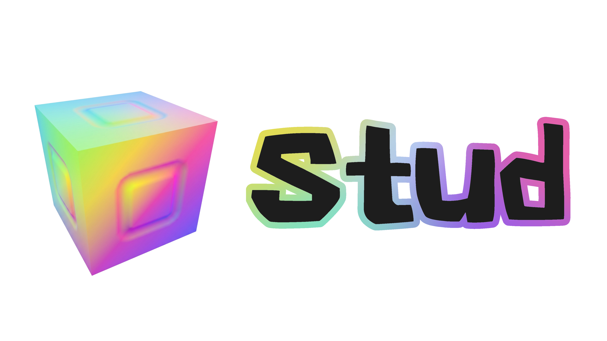
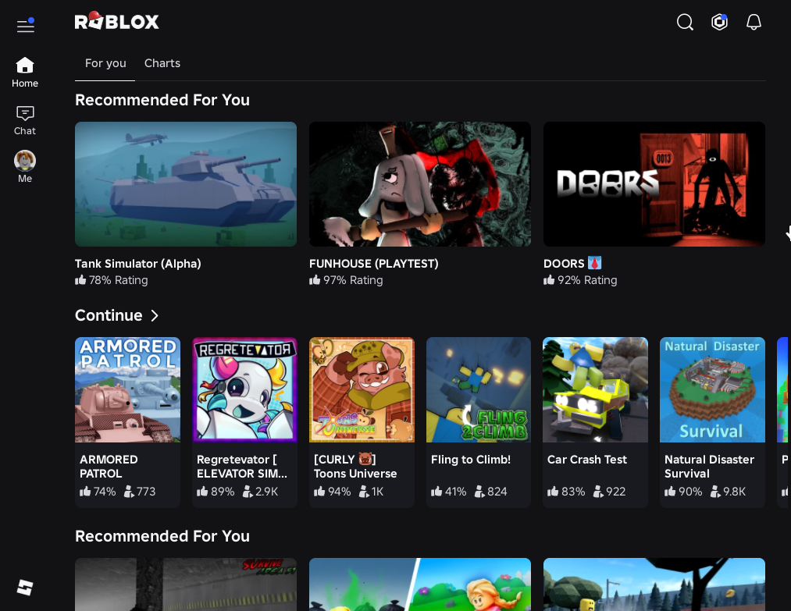
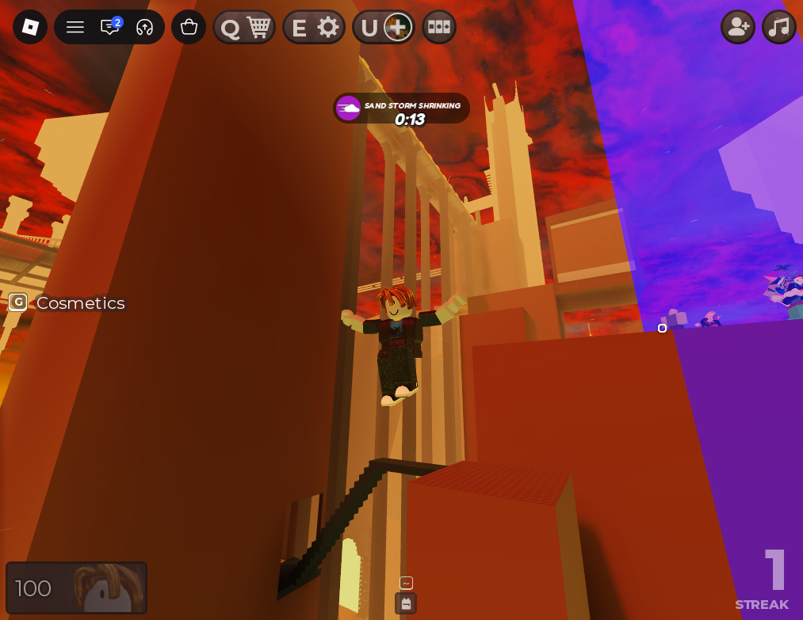
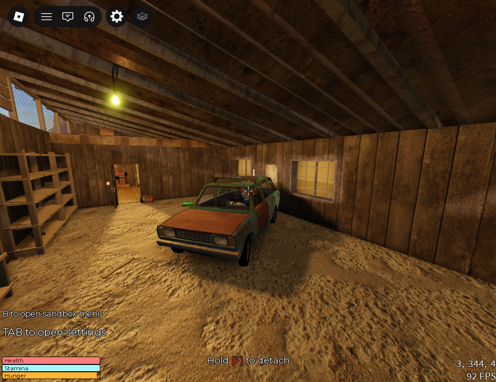
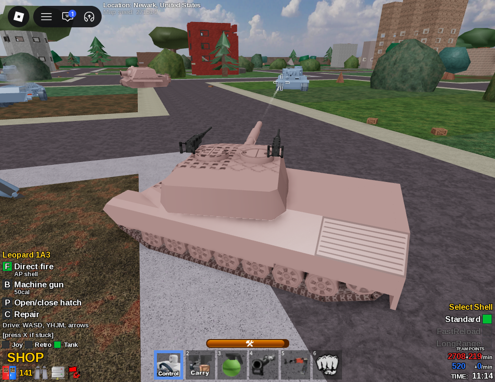
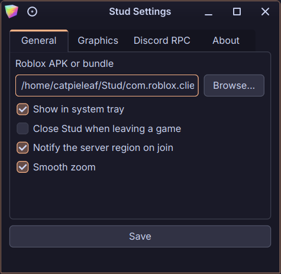
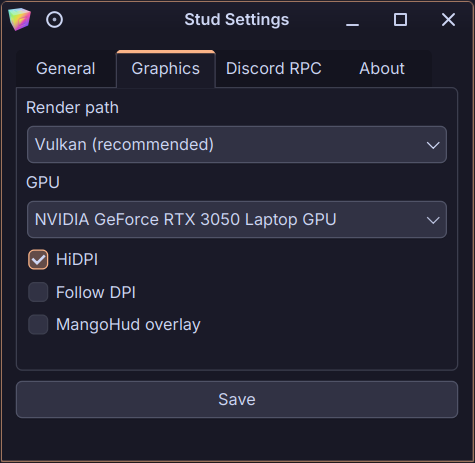
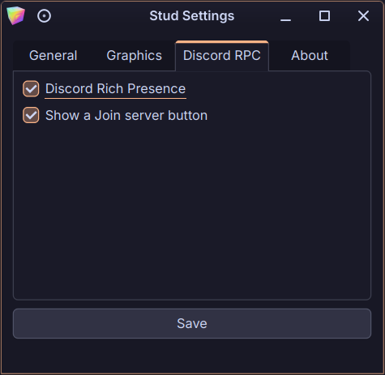
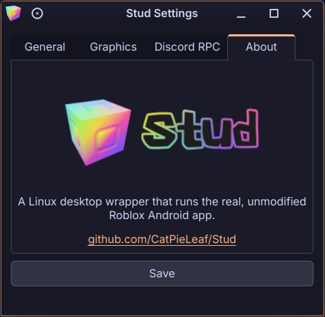

<div align="center">
  </img>
  <br/>
</div>

<div align="center">

<p align="center">
  
  
  
  
</p>

  <p align="center">Play Roblox on Linux: the real Android app, running on your desktop.</p>
</div>

<p align="center">Stud is a <b>launcher</b>. It takes the real Roblox Android app and gives it what it needs to run on a Linux desktop: the Android framework, a window, a mouse and keyboard, and a graphics stack. The engine is never patched, and Roblox is never shipped from here.</p>

<div align="center">

[Screenshots](#screenshots) · [Why?](#why) · [Features](#features) · [Status](#status) · [What Stud is not](#not)

[How it works](#how) · [Building](#building) · [Installation](#installation) · [Getting an APK](#getting-a-roblox-apk) · [Where things live](#files) · [Credits](#credits)

</div>

<br>

<p align="center">
  <a href="https://github.com/CatPieLeaf/Stud/releases"></a>
  <a href="https://cpak.it/store/apps/stud"></a>
</p>

<br>
<div align="center">
  <h4 id="screenshots"></h4>
</div>

<div align="center">
  </img>
  <p><i>The real Roblox home screen, on a Linux desktop.</i></p>
</div>

<table align="center">
  <tr>
    <td><a href="packaging/screenshots/game1.png"></a></td>
    <td><a href="packaging/screenshots/game2.png"></a></td>
    <td><a href="packaging/screenshots/game3.png"></a></td>
  </tr>
</table>

<table align="center">
  <tr>
    <td><a href="packaging/screenshots/settings1.png"></a></td>
    <td><a href="packaging/screenshots/settings2.png"></a></td>
    <td><a href="packaging/screenshots/settings3.png"></a></td>
    <td><a href="packaging/screenshots/settings4.png"></a></td>
  </tr>
</table>

<br>

<div align="center">
  <h4 id="why"></h4>
</div>

I wanted to play Roblox on Linux without it falling over. Sober kept crashing on my NVIDIA machine, and I wanted more control than it gave me: picking my own APK, deciding when Roblox updates, and no OTAs I can't see or turn off.

So I made Stud. The Android runtime (bionic) and the rendering side (glibc) are separate processes, so the graphics driver's threads stay out of the Android code, which is what fixed the NVIDIA crashes for me. You provide the APK yourself, and it's Vulkan first.

It's a one-person project, built because I wanted a launcher that stays out of the way. It works for me, and I hope it works for you too.

<br>

<div align="center">
  <h4 id="features"></h4>
</div>

 - Runs the **real** Roblox Android app, with the engine unpatched
 - Separate processes, as in a browser, so the GPU driver never shares a process with the engine
 - **Vulkan** by default, or **OpenGL** in Settings for hardware Vulkan doesn't run on. OpenGL runs on [gfxstream](https://github.com/google/gfxstream), with MSAA, outlines and Windows Graphical Parity just as on Vulkan
 - **Upscaling**, on by default: the game renders below your screen's resolution and Stud rebuilds the frame at full size. **RAVU-Zoom AR** is the default on Vulkan. **SGSR1 ED** is the lightweight one, for laptops and integrated GPUs, and the default on OpenGL
 - **Sound with nothing to install**: the audio device is built in, and speaks PulseAudio (which reaches PipeWire), ALSA, JACK and OSS. Voice chat is wired up, but hasn't been confirmed in a live session yet
 - Runs on **Wayland and X11**. Stud presents its own frames with no driver swapchain in between, so a late compositor costs a dropped frame instead of holding up the game
 - Controllers, with rumble
 - Smooth zoom, like the Windows client
 - Your login is encrypted on disk with AES-256-GCM, and only the key lives in the system keyring
 - `roblox://` links from a browser open straight into the experience
 - In-app web panels (Messages, account pages, login challenges), and private servers from the server list
 - Copy Link puts the real invite link on your clipboard
 - Screenshots and recordings land in a `Stud` folder inside your Pictures and Videos
 - Discord Rich Presence, with an optional join button
 - Optional notification of which country the game server is in
 - MangoHud and [GameMode](https://github.com/FeralInteractive/gamemode) switches, HiDPI, GPU picker, system tray
 - Caps the frame rate while the window can't be seen
 - Export every session log as one tarball, for when you file a bug
 - Ships as an **rpm** (also in [Terra](https://terra.fyralabs.com)), a **deb**, an Arch **pkg.tar.zst**, a universal **AppImage**, a **Flatpak** and a [cpak](https://github.com/Containerpak/cpak)

## Windows Graphical Parity

Games look the way they do on Windows: real reflections, shine on every material, and surface detail on bricks, wood, metal and the rest, on Vulkan and OpenGL alike.

It's in beta, and on by default. Turn it off in Settings and games look as they do on Android.

<table align="center">
  <tr>
    <td></td>
    <td></td>
  </tr>
  <tr>
    <td></td>
    <td></td>
  </tr>
  <tr>
    <td></td>
    <td></td>
  </tr>
</table>

<br>

<div align="center">
  <h4 id="status"></h4>
</div>

> [!WARNING]
> **Stud is very unstable.** It boots, logs in, renders the real app and joins real games. It also breaks, hangs and does strange things. For now, treat it as something to tinker with, not something to rely on.

**Contributions of any kind are welcome**: code, bug reports, a log from a machine that isn't ours, a GPU we've never tested on, a screenshot of something rendering wrong. Open an [issue](https://github.com/CatPieLeaf/Stud/issues) and say what happened; the tray's **Export logs** puts every session in one file for you.

<br>

<div align="center">
  <h4 id="not"></h4>
</div>

 - **Not affiliated with Roblox.** Stud is an independent project, not endorsed, supported or approved by Roblox Corporation.
 - **Not a distributor.** No Roblox APK is included here, mirrored here, or downloaded by anything here. You supply your own copy, and Roblox remains subject to its own terms.
 - **Not a modding tool.** Stud does not inject code, patch the client, alter game behaviour or give you anything you would not have on a regular client, and it will not gain support for doing so. Requests for that will be ignored and closed.
 - **Not borrowed.** Stud shares no code with Sober or anything like it.
 - **Not an emulator.** There is no Android system image and no virtual machine. The app's own code runs directly, with the pieces it expects supplied around it.

<br>

<div align="center">
  <h4 id="how"></h4>
</div>

| process | runs as | does |
|---|---|---|
| `stud-ui` | glibc, Qt6 | settings, deep links, starting the others, then gets out of the way |
| `stud-runtime-bionic` | real bionic, inside `bwrap` | the engine, the JNI bridge, the Android framework stand-in |
| `stud-render-host` | glibc | Wayland or X11, the GPU driver, Stud's own swapchain, audio |
| `stud-webview` | glibc, Qt WebEngine | web panels and login pages, started when one opens |

Every Vulkan call the engine makes goes from the bionic process to the render host through shared-memory rings, with a Unix socket beside them. In OpenGL mode the engine uses gfxstream's guest libraries and the render host decodes them.

<br>

<div align="center">
  <h4 id="building"></h4>
</div>

> [!NOTE]
> The dependencies need roughly **2.5 GB** of free space, almost all of it Google's NDK.

### 1 - Install the system packages

```bash
sudo dnf install cmake ninja-build meson gcc-c++ python3 qt6-qtbase-devel qt6-qtwebengine-devel \
  qtkeychain-qt6-devel wayland-devel wayland-protocols-devel libxkbcommon-devel \
  libdrm-devel libXi-devel libglvnd-devel vulkan-loader-devel vulkan-headers \
  freetype-devel openssl-devel 'pkgconfig(libavcodec)' 'pkgconfig(libavutil)' \
  'pkgconfig(libswscale)' bubblewrap wl-clipboard
```

<details>
<summary>Debian / Ubuntu</summary>

```bash
sudo apt install cmake ninja-build meson build-essential python3 qt6-base-dev libqt6opengl6-dev \
  qt6-webengine-dev qtkeychain-qt6-dev libwayland-dev wayland-protocols libwayland-egl-backend-dev \
  libdrm-dev libxkbcommon-dev libxi-dev libxcb-dri3-dev libxcb-present-dev \
  libegl1-mesa-dev libgles2-mesa-dev libvulkan-dev libfreetype-dev libssl-dev \
  libavcodec-dev libavutil-dev libswscale-dev bubblewrap wl-clipboard
```
</details>

FFmpeg's headers are optional: without them, in-game video has no decoders. `wl-clipboard` (or `xclip` on X11) is what Copy Link uses.

### 2 - Dependencies

Google's NDK and a real bionic from AOSP can't live in this repository. This puts both in `third_party/`:

```bash
tools/setup.sh --plan   # what it would fetch, and from where
tools/setup.sh          # actually fetch it
```

> [!TIP]
> Already have an NDK? Skip the download with `STUD_NDK_SRC=/path/to/android-ndk-r28c tools/setup.sh`.

### 3 - Build and run

```bash
cmake -S . -B build -G Ninja
cmake --build build
./build/ui/stud-ui
```

The first launch opens Settings, because Stud has no Roblox APK yet. [Get one](#getting-a-roblox-apk), point Stud at it and save. Every launch after that goes straight to Roblox.

<details>
<summary>Making packages</summary>

```bash
cd build
cpack -G RPM                  # build/stud-<version>-1.x86_64.rpm
cpack -G DEB                  # build/stud_<version>_amd64.deb
cd ..
packaging/build-appimage.sh   # build-appimage/packages/Stud-x86_64.AppImage
```

None of them contains Roblox. The AppImage builds inside a container, so it needs `podman` or `docker`. A deb runs on the distribution that built it and anything newer.
</details>

<details>
<summary>Running the tests</summary>

```bash
ctest --test-dir build
```

Tests that need a GPU, a keychain or a notification service report skipped without one. On a desktop, one real "Stud test" notification pops up.
</details>

<details>
<summary>Profiling and debugging</summary>

Every debugging switch is listed in [`docs/environment.md`](docs/environment.md).

For a stall a log can't explain, `-DSTUD_TRACY=ON` builds the render host with the [Tracy](https://github.com/wolfpld/tracy) client, which collects nothing until a profiler connects. It's off by default, and not even downloaded then.
</details>

<br>

<div align="center">
  <h4 id="installation"></h4>
</div>

Pre-built packages are on the [Releases](https://github.com/CatPieLeaf/Stud/releases) page. Whichever you pick, you'll also need [a Roblox APK](#getting-a-roblox-apk).

## 🔵 R P M  ( F E D O R A )

Stud is in [Terra](https://terra.fyralabs.com), so it installs and updates like any other package. Add the Terra repository once:

```bash
sudo dnf install --nogpgcheck --repofrompath 'terra,https://repos.fyralabs.com/terra$releasever' terra-release
```

Then install Stud:

```bash
sudo dnf install stud
```

Or install the rpm from a release by hand:

```bash
sudo dnf install ./stud-*.x86_64.rpm
```

## 🟣 D E B  ( D E B I A N  /  U B U N T U )

```bash
sudo apt install ./stud_*_amd64.deb
```

Installs and starts on Ubuntu 24.04, Debian 13, Ubuntu 26.04 and the Mint releases built on them.

## 🔷 A R C H  ( P A C M A N )

Stud is not on the AUR. Get the package from [Releases](https://github.com/CatPieLeaf/Stud/releases):

```bash
sudo pacman -U stud-*-x86_64.pkg.tar.zst
```

To build from source instead, use the PKGBUILD at `packaging/aur/`.

## 🔶 F L A T P A K

```bash
flatpak install --user ./stud-*-x86_64.flatpak
flatpak run io.github.catpieleaf.Stud
```

Not on Flathub yet, so it's a file attached to each release rather than a remote. The manifest is in `packaging/flatpak`.

## ⬛ C P A K

```bash
cpak install github.com/catpieleaf/stud
```

[cpak](https://github.com/Containerpak/cpak) installs from an OCI image and runs it rootless. Stud is in the [cpak store](https://cpak.it/store/apps/stud). Only your Downloads folder is visible to it, so keep your APK there.

## ❄️ N I X

```bash
nix run github:CatPieLeaf/Stud
```

Or on NixOS, add the flake as an input and install it system-wide:

```nix
# flake.nix
{
  inputs.nixpkgs.url = "github:NixOS/nixpkgs/nixos-unstable";
  inputs.stud.url = "github:CatPieLeaf/Stud";

  outputs = { nixpkgs, stud, ... }: {
    nixosConfigurations.nixos = nixpkgs.lib.nixosSystem {
      modules = [
        { nixpkgs.overlays = [ stud.overlays.default ]; }
        ./configuration.nix
      ];
    };
  };
}

# configuration.nix
environment.systemPackages = [ pkgs.stud ];
hardware.graphics.enable = true;
```

Use your own host name in place of `nixos`. On Nix outside NixOS, run it through [nixGL](https://github.com/nix-community/nixGL) so it can find your graphics driver.

## 🟠 A P P I M A G E  ( A N Y _ D I S T R O )

```bash
chmod +x Stud-x86_64.AppImage
./Stud-x86_64.AppImage
```

> [!TIP]
> Run this once to get a taskbar icon and make `roblox://` links from your browser open Stud:
> ```bash
> ./Stud-x86_64.AppImage --install-desktop-entry
> ```

> [!NOTE]
> Install `bubblewrap` from your package manager: the AppImage deliberately doesn't bundle it, because it needs your distribution's AppArmor or SELinux policy. The other packages take care of it for you.
>
> The rpm and Arch package need glibc 2.43: Fedora 44+ or a current rolling release. The AppImage carries its own glibc, so it's the one to use on anything older.

## Getting a Roblox APK

Stud doesn't include Roblox, so you bring your own copy, and you choose when it updates. It must be the **x86_64** build: Stud refuses one without it. `.apk`, `.apkm`, `.apks` and `.xapk` all work, and a bundle has to be complete, not just the x86_64 split on its own.

Two ways to get one. Neither is run by or affiliated with Stud:

 - **[apk-fetch](https://github.com/8LWXpg/apk-fetch)**, a command-line downloader. Ask for x86_64, because its default is arm64:
   ```bash
   apk-fetch get com.roblox.client --arch x86_64
   ```
 - **[APKMirror](https://www.apkmirror.com/apk/roblox-corporation/roblox/)**: pick a release, then a variant that lists x86_64.

Then open Settings in Stud, pick the file and save. It's copied in, so you can delete the download.

<br>

<div align="center">
  <h4 id="files"></h4>
</div>

| path | what |
|---|---|
| `~/.config/stud/` | `config.json`, and `flags.json` if you hand-write FFlag overrides. `"webLogin": false` in `config.json` goes back to the app's own login screens; it isn't in Settings |
| `~/.local/share/stud/` | your APK, the encrypted login, and the engine's own data |
| `~/.cache/stud/` | the extracted engine, assets and caches, safe to delete |
| `~/.local/state/stud/logs/` | one log per session, from every process. This is the file to read when something goes wrong, and the one to attach to a bug report |

In a Flatpak these live under the sandbox's own home, so `~/.config/stud/` becomes `~/.var/app/io.github.catpieleaf.Stud/config/stud/` and the rest follow.

<br>

<div align="center">
  <h4 id="credits"></h4>
</div>

Roblox is a trademark of Roblox Corporation. Stud is an independent, non-commercial project and is not affiliated with, endorsed by or supported by them.

 - [bionic](https://android.googlesource.com/platform/bionic/): Android's C library, from AOSP's prebuilt Runtime APEX (BSD / Apache-2.0)
 - [libjnivm](https://github.com/ChristopherHX/libjnivm): the JNI virtual machine under Stud's Java layer (MIT)
 - [gfxstream](https://github.com/google/gfxstream): OpenGL mode, the ring that carries Vulkan commands, and the ETC2/EAC texture decoders, patched by `third_party/gfxstream/stud.patch` (Apache-2.0)
 - [Mesa](https://gitlab.freedesktop.org/mesa/mesa): gfxstream's guest ring stream (MIT)
 - [mpv-prescalers](https://github.com/bjin/mpv-prescalers): the RAVU-Zoom upscaler (LGPL-3.0-or-later)
 - [Snapdragon Game Super Resolution](https://github.com/SnapdragonStudios/snapdragon-gsr): the SGSR upscaler (BSD-3-Clause)
 - [AMD FidelityFX Super Resolution 1](https://github.com/GPUOpen-Effects/FidelityFX-FSR): RCAS, the sharpening pass after RAVU (MIT)
 - [miniaudio](https://github.com/mackron/miniaudio): the audio device (public domain or MIT-0)
 - [Zydis](https://github.com/zyantific/zydis) and [Zycore](https://github.com/zyantific/zycore-c): read the engine's code to find what Stud needs, instead of byte patterns that change every build (MIT)
 - [volk](https://github.com/zeux/volk): Vulkan entry points (MIT)
 - [xxHash](https://github.com/Cyan4973/xxHash): the texture cache's key (BSD-2-Clause)
 - [libdecor](https://gitlab.freedesktop.org/libdecor/libdecor): window decorations where the compositor has none, optional at runtime (MIT)
 - [wayland-protocols](https://gitlab.freedesktop.org/wayland/wayland-protocols) and [libdrm](https://gitlab.freedesktop.org/mesa/drm): Stud's present layer (MIT)
 - [nlohmann/json](https://github.com/nlohmann/json), [miniz](https://github.com/richgel999/miniz), [detex](https://github.com/hglm/detex), [PVRTDecompress](https://github.com/powervr-graphics/Native_SDK) (MIT)
 - Qt, and on the AppImage the Breeze widget style (LGPL)
 - [Anylinux AppImages](https://github.com/pkgforge-dev/Anylinux-AppImages), [uruntime](https://github.com/VHSgunzo/uruntime) and [sharun](https://github.com/VHSgunzo/sharun): how the AppImage is built and run (MIT)
 - [Boblox Classic](https://www.deviantart.com/ripoof/art/Roblox-Classic-FONT-880246616): the typeface in Stud's logo, by ripoof. The font itself is not shipped

Stud itself is **AGPLv3**, with one additional permission under section 7 ([`LICENSE.exception`](LICENSE.exception)) covering the Roblox engine Stud loads but never distributes. Stud is and always will be Open Source.

[`NOTICE.md`](NOTICE.md) covers the rest: every third-party licence, trademarks, your Roblox account, and what does and does not leave your machine. A package installs each licence to `/usr/share/licenses/stud/`.

---
<br>

<div align="center">
  </img>
</div>
